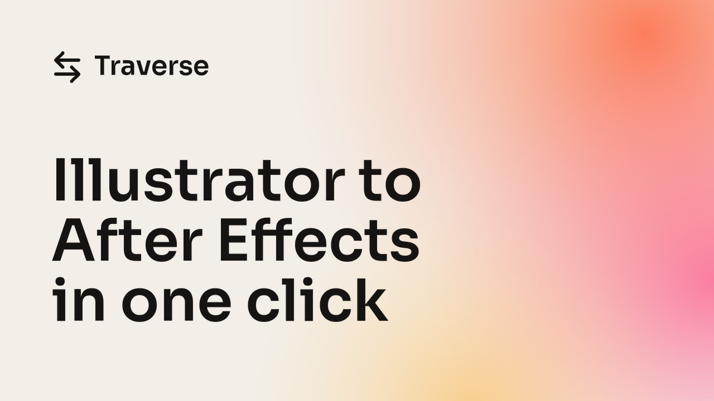

# Traverse

A panel for Illustrator and After Effects. Select artwork in Illustrator, press Push, and it shows up in your comp as shape and text layers. No import step, no rebuilding.

**[Download the latest version](https://github.com/traverse-plugin/traverse/releases/latest)** · [Website](https://traverse-plugin.github.io/) · [Gumroad (pay what you want)](https://traverseplugin.gumroad.com/l/traverse)

It's free. If it saves you time and you feel like paying something, the Gumroad page takes any amount, including 0.

## What comes across

- Gradients, linear and radial, on fills and strokes, with every stop
- Text as text, with its fonts, sizes and colours
- Strokes with dashes, caps and joins
- Clipping masks, as layer masks
- CMYK documents, converted so the colours don't go grey
- Rectangles and ellipses as parametric shapes
- After Effects shapes and text back to Illustrator

## Sync

Turn on "Remember for Sync" when you push. When the design changes later, fix it in Illustrator and press Sync: the layer you already animated gets the new shape, colour or wording, and the keyframes stay.

## Install

Unzip and follow the guide inside (English and Spanish).

- **Mac:** run the installer. It isn't signed by Apple yet, so macOS will ask you to allow it once in System Settings > Privacy & Security.
- **Windows:** script install, still in beta.

Restart Illustrator and After Effects, then open Window > Extensions > Traverse in both.

## Requirements and limits

- Illustrator 2021 or newer, After Effects 2021 or newer
- Gradients need After Effects 2026. Mixed text styles need After Effects 24.3 or newer
- Tested on macOS with the 2026 apps. Windows hasn't had much testing
- Freeform gradients, meshes, patterns and live effects arrive as an image

## Problems

Open an [issue](https://github.com/traverse-plugin/traverse/issues) with your app versions and, if you can, the file that broke.

Traverse is not affiliated with or endorsed by Adobe. Illustrator and After Effects are trademarks of Adobe.
